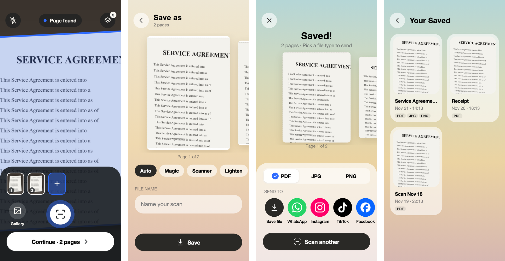

<p align="center">
  
</p>

<h1 align="center">SalinLens</h1>
<p align="center"><b>Scan it. Tidy it. Send it.</b><br/>A fast, private document scanner for Android.</p>

<p align="center">
  
</p>

SalinLens turns your phone camera into a pocket scanner. Point at a page, let it find the corners, fix the crop if needed, add more pages, and save a clean PDF or images you can send straight to WhatsApp, Instagram, Telegram and friends.

It is a small native app: the UI is written in [ReactLynx](https://lynxjs.org) (Lynx 4.2) and everything heavy (camera, perspective correction, filters, PDF export, sharing) is Kotlin. No account, no ads, no network.

## Features

- **Live camera with automatic page detection**: the page outline is tracked on screen and the shutter snaps the corners for you.
- **Multi-page sessions**: shoot several pages, import from the gallery, tap any page in the strip to adjust it, delete or add more.
- **Crop editor on the same screen**: drag the corners, rotate, auto-fit or use the full page.
- **Nine filters**: Auto, Magic, Scanner, Lighten, Crisp, Eco, Gray, B&W, Original.
- **Save as**: swipe through your pages (snap carousel), pick a filter, name the file. Every scan is written as **PDF** (all pages in one file) plus **JPG** and **PNG** (one file per page).
- **Saved screen**: swipe the pages again, pick one file type, then **Save file** to your phone (`Documents/SalinLens` or `Pictures/SalinLens`) or send it to an app.
- **Send to 16 apps** plus the system share sheet: WhatsApp, Instagram, TikTok, Telegram, Facebook, Messenger, X, Snapchat, Discord, Gmail, Signal, Pinterest, Reddit, Threads, LINE, Viber. Installed apps come first.
- **Your Saved**: a two-column gallery of everything you scanned.
- **Private by design**: the manifest only asks for `CAMERA` and `VIBRATE`. There is no `INTERNET` permission, so nothing can leave the phone.

## Tech

| Layer | What |
|---|---|
| UI | ReactLynx 0.129 (Lynx 4.2), TypeScript, hand-written CSS |
| Native | Kotlin, CameraX, ONNX Runtime (edge detection), `android.graphics.pdf` |
| Bridge | one Lynx module (`SalinNative`) with JSON-string results, typed in `web/src/native.ts` |
| Custom elements | `salin-camera`, `salin-crop`, `salin-photo`, `salin-icon` (icons drawn from path data, no bitmaps) |
| Targets | `minSdk 26`, `targetSdk 35`, `arm64-v8a` |

## Build

Requirements: JDK 17, Android SDK (API 36), Node 20+ and pnpm.

```sh
cd web && pnpm install
cd ../android && ./gradlew :app:assembleRelease     # builds the Lynx bundle first
```

The APK lands in `android/app/build/outputs/apk/release/app-release.apk`. For convenience it is signed with your local debug keystore (`~/.android/debug.keystore`); swap in your own key before publishing anywhere.

### Edge-detection model

Automatic page detection uses a small ONNX mask network. **The trained weights are not included in this repository** (they were trained on data with ShareAlike terms, and I have not settled how they can be distributed). Without the file the app still works: detection is simply off and the crop starts as an inset rectangle that you drag into place.

To enable detection, drop a compatible model at:

```
android/app/src/main/assets/docnet.onnx
```

Contract the app expects:

- input `x`: float32 `[1, 3, 192, 320]`, RGB, values in `0..1`, a **landscape** frame (portrait photos are rotated 90 degrees before inference and the result is rotated back)
- output: one-channel mask logits `[1, 1, 192, 320]` (a sigmoid is applied in the app), where the page is foreground
- `QuadFromMask.kt` turns the mask into four corners and a confidence; results below `0.55` are ignored

## Project layout

```
android/   Kotlin app: camera, crop, imaging, export, share, Lynx host
web/       ReactLynx UI (src/), design tokens in src/theme.css
web/preview  runs the real UI bundle in headless Chromium with a mocked native module
docs/      logo and screenshots
```

Screens live in `web/src/screens/` (Scan, Export = "Save as", Item = "Saved", Gallery, Splash). Navigation is a small stack in `web/src/App.tsx`.

## Testing the UI without a phone

The UI bundle runs in Chromium through `@lynx-js/web-core`, with the native module replaced by `web/preview/native-mock.js`.

```sh
cd web
pnpm test:web    # screenshot every screen at 4 phone sizes, flag clipped / overlapping / off-screen content
pnpm stress      # long, rapid and failing flows: hit-tests every button, checks screen stack, spinners, JS errors
pnpm preview     # open the bundle in a browser with the mock
pnpm show        # one page with screenshots of every real screen
```

`pnpm stress` covers full scan cycles (many pages, adjust, save, save to file, back to camera), double-tap and back spam, every native call failing or being slow, camera unavailable or denied, and empty / large galleries.

This verifies layout and logic, **not** native rendering. Some things only show up on a device, for example Lynx elements that exist in the web layer but not on Android, or flex sizing differences, so always check an APK too.

## Credits

- Brand glyphs for the Send to row come from [Simple Icons](https://simpleicons.org) (CC0). The logos themselves belong to their respective owners and are used only to identify the apps.
- UI framework: [Lynx](https://lynxjs.org). Inference: [ONNX Runtime](https://onnxruntime.ai). Camera: [CameraX](https://developer.android.com/media/camera/camerax).

## License

The source code is released under the [MIT License](LICENSE). Model weights, if you add your own, are covered by whatever licence they came with.
